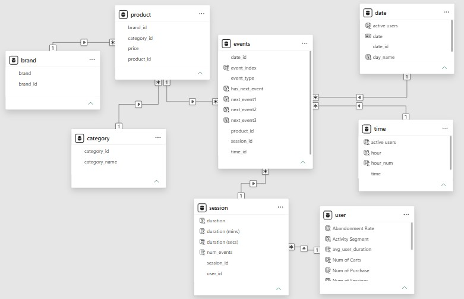

# E-Commerce User Behavior Analysis: Engagement, Cart Abandonment & User Personas

An end-to-end analytics project using PowerQuery and PowerBI to analyze 28M+ shopping events from a multi-category online store (October 2019).

## Table of Contents
- Business Problem
- Key Findings
- Dataset
- Tools & Technologies
- Methodology
  - Data Cleaning
  - Data Modeling
  - DAX Measures
  - Dashboards
- User Personas
- Recommendations
- Limitations
  

## Business Problem
The store attracts a very large audience, but mist visitors never buy. This project aims to answer to questions:
1. **Who are the store's users?** What do their engagement patterns, session frequency, spending, and cart abandonment look like, and *what distinct personas emerge*?
2. **How can the store grow?** Which actions would improve engagement, cart conversion, and sales?

## Key Findings

| Metric | Value |
| --- | ---: |
| Total views | 27, 542, 941 |
| Total cart additions | 820, 790 |
| Total purchases | 569, 424 |
| Cart abandonment rate | 30.62% |
| Unique users | 2, 408, 159 |
| Avg. sessions per user | < 3 |
| Avg. session duration | 6.77 min |
| Avg. events per session | 4 |
| Users with no spending | 88.93% |
| Share of purchases in Electronics | 74.29% |

### Highlights
- Customer retention is a core issue. While the store attracts many visitors, it is poor at keeping them as most users have very few sessions and the large majority never made purchases.
- Electronics drives the business. Samsung and Apple each generated over 4M engagements, and electronics account for roughly three quarters of total purchases.
- Timing patterns in activity emerged. Cart additions and purchases peak from Tuesday through Friday, while overall engagement is highest between 2 and 5 PM (UTC), gradually declining through 11 PM.
- Low-activity users abandon carts the most. Users with fewer than 5 sessions have the highest per-user cart abandonment rate (47.99%), and 81.77% of them never purchase.
- Heavy browsers rarely buy. Most high-activity users (>15 sessions) make no purchases.

## Dataset
The data used for this analysis was obtained from a Kaggle dataset posted by Michael Kechinov. The file contains behavior data of a large multi-category online store’s users for October 2019. Each row represents an event classified as view, cart, and purchase.  

Source: [eCommerce behavior data from multi-category store](https://www.kaggle.com/datasets/mkechinov/ecommerce-behavior-data-from-multi-category-store) 

| Column | Description |
| --- | --- |
| `event_time` | Time of the event (in UTC) |
| `event_type` | view, cart, or purchase |
| `product_id` | Unique product ID |
| `category_id` | Unique category ID |
| `category_code` | Category code name, can be null |
| `brand` | Lowercased brand name, can be null |
| `price` | Product price (float) |
| `user_id` | Permanent unique user ID |
| `user_session` | Temporary session ID (changes when user comes back after a long pause) |

> **How to Read:** User `user_id` during session `user_session` added to shopping cart (property `event_type` is equal `cart`) product `product_id` of brand `brand` of category `category_code` (`category_code`) with price `price` at `event_time`.

## Tools & Technologies
- Power Query: data cleaning and transformation
- PowerBI: data modeling, DAX, and dashboards
- DAX: calculated columns and measures

## Methodology
### 1. Data Cleaning 
- Split `event_time` into separate date and time columns and set the correct data types.
- Split `category_code` into three levels and kept the top level for simplicity (e.g. appliances.kitchen.microwave and appliances.environment.water_heater both become appliances).
- Removed the original `category_id` and generated new unique IDs for the simplified categories.
- Dropped rows with a null `category_code` (~32% of the original data), leaving 28,933,155 of events. Category is central to the persona analysis, so uncategorized events could not support those findings. Due to hardware limitations, working with the full dataset in Power BI was also impractical, so this reduction made the data manageable. Results therefore reflect categorized activity only (see [Limitations](#limitations)).

### 2. Data Modeling (Snowflake Schema)
The cleaned data was normalized was then normalized into a snowflake schema eith `Event` as the fact table.

**Data Model**

| Table |	Columns |
| --- | --- |
| Event (fact)	| time_id, date_id, event_type, product_id, session_id
| Product	| product_id, product_code, price, category_id, brand_id
| Category | category_id, category_name
| Brand	| brand_id, brand_name
| User | user_id, num_sessions, num_carts, num_purchases, spending_segment, activity_segment, abandonment_rate, avg_duration
| Session	| session_id, duration_secs, duration_mins, num_events
| Time | time_id, time, hour
| Date | date_id, date, day_name, day_order |

> **Relationships**: Event links to Time (time_id), Date (date_id), Session (session_id), and Product (product_id). Product links to Brand (brand_id) and Category (category_id).

>Calculated columns (hour, day_name, duration, etc.) were added with DAX in preparation for analysis.

### 3. DAX Measures

## DAX Measures

| Measure | Definition | DAX |
| --- | --- | --- |
| Total Views | Count of view events | `CALCULATE(COUNTROWS('events'), 'events'[event_type] = "view")` |
| Total Cart | Count of cart events | `CALCULATE(COUNTROWS('events'), 'events'[event_type] = "cart")` |
| Total Purchases | Count of purchase events | `CALCULATE(COUNTROWS('events'), 'events'[event_type] = "purchase")` |
| Total Spending | Sum of prices of purchased products | `SUMX(FILTER('events', 'events'[event_type] = "purchase"), RELATED('product'[price]))` |
| Abandonment Rate | Share of cart additions that did not result in a purchase | `1 - [Total Purchases] / [Total Cart]` |
| Avg Views per Day | Average daily views | `DIVIDE([Total Views], DISTINCTCOUNT('date'[date]))` |
| Avg Num Events | Average events per session | `AVERAGE('session'[num_events])` |
| Avg Session Duration | Average session length (minutes) | `AVERAGE('session'[duration (mins)])` |
| Avg Duration per User | Average of per-user average duration | `AVERAGE('user'[avg_user_duration])` |
| Avg Num of Sessions | Average sessions per user | `AVERAGE('user'[Num of Sessions])` |
| Total Users | Count of unique users | `COUNTROWS('user')` |

### 4. Dashboards

## User Personas
Three personas emerged from the activity, spending, and category data.

| | Tech Enthusiast | Window Shopper | Casual/One-Time Shopper |
| --- | --- | --- | --- |
| Who they are | Customers who mostly engage with Electronics category | Heavy browsers who add to cart but rarely buy | Users with few sessions who explore or compare prices |
| Evidence | Electronics account for 74.29% of all the purchases made; Top buyers belong here; prefer Samsung and Apple; major revenue contributors | Non-spenders comprise 88.93% of users; average 98.27% cart abandonment per non-spending users; most high activity users (>15 sessions) don't purchase | Fewer than 5 sessions; 81.77% never purchase; highest per-user abandonment among segments ( 47.99%) |
| Likely behavior | Brand-driven, repeat buyers | May wait for discounts or sales | Visiting once to explore or compare prices |

## Recommendations

Tech Enthusiasts: 

- Offer electronics-exclusive deals and bundles.
- Prioritize Samsung and Apple in inventory planning to avoid stockouts.
- Provide early access to new launches and limited-time deals.

Window Shoppers: 

- Send price-drop alerts for items in their carts.
- Run flash sales and limited-time offers to create urgency.
- Use push notifications (app, SMS, email) for abandoned-cart reminders.

Casual / One-Time Shoppers:

- Add limited-time offers to encourage return visits.
- Offer incentives (discounts, free shipping, freebies) for first-time and returning users.
- Launch a loyalty rewards program to drive re-engagement.

## Limitations